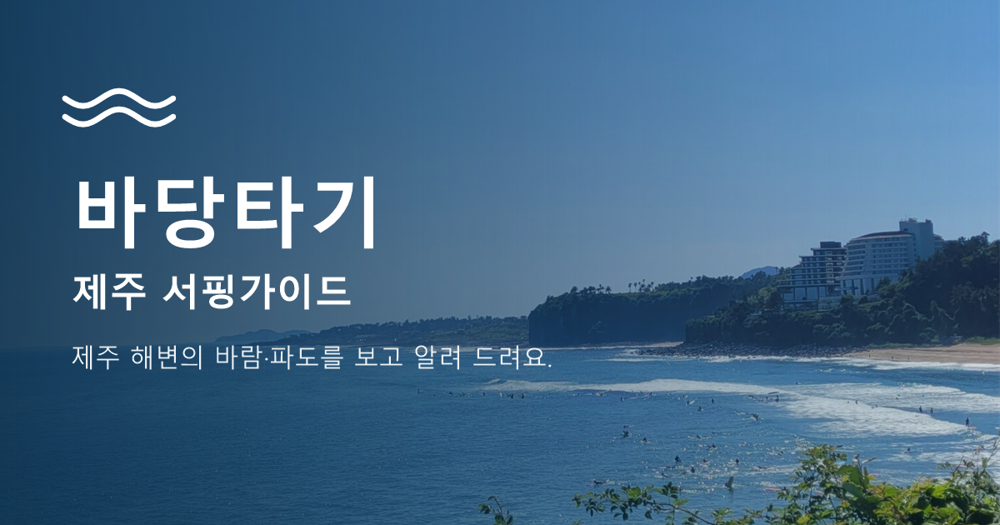

# 🏄 바당타기 (제주 서핑·레저 가이드)

제주의 **서핑 · 윈드서핑 · 패러글라이딩** 장소별 **풍속·돌풍·파도**를 보고 지금 해도 되는지 **가능 / 주의 / 위험**으로 알려 주고,
제주 4개 해역의 **바다 지수**, 서핑 업체(**서핑시설**), 관광지·해변·**레저 시설**(지도 + 목록), 주변 **맛집 · 카페 · 공용 샤워실**, **AI 가이드**를 함께 보여 주는 웹 서비스입니다.
(Vite + React + Router + Zustand + Bootstrap + Supabase, 서버 함수는 `api/`)

- 배포 주소: https://jejubadatagi.vercel.app (Vercel)
- QR 코드: [`public/images/qr.png`](public/images/qr.png) (배포 주소로 연결)

> ⚠️ 판정 기준은 초보자 기준의 **학습·참고용 예시값**입니다. 실제 활동 전에는 기상특보와 현장 강사·업체의 안내를 따르세요.

## 실행
```bash
npm install
cp .env.example .env.local     # 값 채우기 (Windows: copy .env.example .env.local)
npm run dev                    # 화면 + /api 서버 함수 (http://localhost:5173)
```
`npm run dev` 만으로 `/api` 가 동작합니다. (개발용 플러그인 `dev/api-plugin.js` — Vercel 로그인·CLI 불필요, 배포에는 쓰이지 않음)
배포와 똑같이 실행하려면 `vercel dev` 를 쓸 수도 있습니다.
`.env.local` 은 **서버를 켤 때만** 읽으므로, 값을 바꾸면 `npm run dev` 를 껐다 켜세요. 관광지 목록 등은 서버가 24시간 저장해 두므로 코드를 바꾼 뒤에도 서버를 다시 켜야 반영됩니다.

### 환경 변수 (`.env.local`, 배포 때는 Vercel 환경변수)
| 이름 | 용도 | 없으면 |
|---|---|---|
| `VITE_SUPABASE_URL`, `VITE_SUPABASE_ANON_KEY` | 회원·즐겨찾기 (브라우저용, 공개돼도 되는 값) | 로그인·즐겨찾기가 안 됨 |
| `DATA_GO_KR_KEY` (또는 `TOUR_API_KEY`) | 한국관광공사·기상청·해양조사원 바다 지수 (공공데이터포털 Decoding 키, 서버 전용) | 관광지·주변 정보·예보·바다 지수가 "정보 없음" |
| `VISITJEJU_API_KEY` | 비짓제주(제주관광공사) 관광정보 (서버 전용): 해변 사진, 관광지·레저 시설, 주변 맛집·카페 | 사진 없는 해변이 빈 이미지, 레저 시설·추가 관광지가 빠짐, 주변 맛집·카페는 한국관광공사로 대신 |
| `GEMINI_API_KEY` | AI 가이드 — Google Gemini (서버 전용, [AI Studio](https://aistudio.google.com/apikey) 에서 무료 발급) | AI 가이드에 키 안내 문구 표시 |
| `ANTHROPIC_API_KEY` | AI 가이드 — Claude (서버 전용). 선택 사항 | 위와 같음 (둘 다 없을 때만) |
| `AI_PROVIDER` (선택) | `gemini` · `anthropic` · `auto`(기본: 키가 있는 쪽, 둘 다 있으면 Gemini 먼저). 먼저 고른 쪽이 실패하면 다른 쪽으로 대신 답함 | - |
| `GEMINI_MODEL` (선택) | Gemini 모델 이름. 기본 `gemini-3.5-flash` (모델 이름은 자주 바뀌므로 AI Studio 의 목록에서 확인) | - |

`VITE_` 가 붙은 값만 브라우저에 들어갑니다. **서버 키에는 절대 `VITE_` 를 붙이지 마세요.** 바람·파도(Open-Meteo)는 키가 필요 없습니다.
`.env.local` 한 줄은 **`이름=값` 만** 쓰세요. 값 뒤에 `# 설명` 을 붙이면 설명까지 값으로 읽혀 키가 틀려집니다.

## 배포 (Vercel)
1. GitHub 저장소를 Vercel 프로젝트에 연결하면 `main` 에 푸시할 때마다 자동 배포됩니다. (`vercel.json`: 서울 지역, `api/` 를 뺀 모든 주소를 `index.html` 로 돌려 새로고침해도 404가 안 남)
2. **Settings → Environment Variables** 에 위 표의 키를 **같은 이름**으로 넣습니다. `.env.local` 은 GitHub 에 올라가지 않으므로 배포에는 자동으로 들어가지 않습니다.
   - `VITE_` 로 시작하는 값은 **빌드할 때** 화면 코드에 들어가므로, 넣은 뒤 반드시 **Redeploy** 하세요.
3. 로그인을 쓰려면 Supabase 의 **Authentication → URL Configuration** 에 배포 주소를 **Site URL / Redirect URLs** 로 넣습니다.
4. 배포 뒤 `/api/hello` 를 열어 `hasDataKey`·`hasGeminiKey` 가 `true` 인지 확인합니다. (키 값은 나오지 않고 있는지 여부만 나옴)
5. **서버 함수는 `api/` 파일 수만큼** 생깁니다. 지금 **12개**이고, Vercel 무료(Hobby) 플랜의 한도(12개)에 딱 맞습니다. 하나를 더 만들려면 화면에서 쓰지 않는 함수(`forecast`, `beaches` 등)를 먼저 정리하세요.

### 링크 공유·모바일 홈 화면
`index.html` 과 `public/` 에 설정돼 있습니다.
| 항목 | 내용 |
|---|---|
| OG 메타태그 | 제목 "바당타기 · 제주 서핑가이드", 설명 "제주 해변의 바람·파도를 보고 알려 드려요.", 이미지 `/images/og.png`, 주소 `https://jejubadatagi.vercel.app/` |
| 아이콘 | `public/favicon.svg`(탭), `public/images/icon-180·192·512.png`(apple-touch-icon · 홈 화면) |
| manifest | `public/manifest.webmanifest` — 이름 "바당타기 · 제주 서핑가이드", 짧은 이름 "바당타기", `display: standalone`, 테마색 `#3a6c94` |
| QR | `public/images/qr.png` — 배포 주소로 새로 생성한 흰 배경·검정 QR (해독으로 주소 일치 확인) |
배포 주소를 바꾸면 **OG 주소와 QR 을 다시 만들어야** 합니다.

| QR 코드 (스캔하면 배포 사이트로 이동) | 링크 공유 미리보기 (OG 이미지) |
|---|---|
|  |  |

## Supabase 준비 (회원 기능)
Supabase 대시보드에서 아래 순서로 한 번씩 합니다.

1. **SQL Editor** 에서 `supabase/favorites.sql` 전체 실행 — 즐겨찾기를 **로그인한 사용자별**로 저장하는 테이블과 보안 정책.
   (닉네임 방식으로 저장했던 이전 행은 지워집니다. 여러 번 실행해도 안전)
2. **SQL Editor** 에서 `supabase/account.sql` 전체 실행 — **회원 삭제** 함수.
3. **Authentication → Sign In / Providers → Email** 에서 **Confirm email** 설정을 정합니다.
   - 켜 두면: 가입 후 받은 메일의 링크를 눌러야 로그인할 수 있습니다. (화면에 "메일을 확인하세요"가 나옴)
   - 끄면: 가입하자마자 로그인됩니다. 수업·개발 중에는 끄는 편이 편해요.
4. `npm run check:supabase` 로 위 1·2번이 반영됐는지 확인합니다.

## 화면
상단 메뉴 순서: **홈 → 서핑 → 서핑시설 → 관광지 → 내 즐겨찾기**
| 주소 | 내용 |
|---|---|
| `/` | 첫 화면은 제주 바다 **사진 슬라이드**(10초마다 자동 전환, 화살표·점·스와이프, 휠을 내리면 아래로). 이어서 소개 문구 · **오늘 날씨**(제주시·서귀포시) · **바다 지수**(제주 4개 해역: 종합지수·수온·파도·풍속·조석·날씨) · **지금 현황**(가능/주의/위험 개수와 장소별 한 줄, "상세" 버튼) · 내 계정. 개발자용 **동작 체크**는 숨겨져 있고 `/?check` 로 열면 보임 |
| `/sites` | **서핑** (메뉴 이름) — 서핑 장소 14곳(서핑 11 · 윈드서핑 2 · 패러글라이딩 1)의 판정 색 **지도**(마커 클릭 → 조건·상세) + 장소 카드, 활동 필터, "지도에서 보기", "상세" |
| `/sites/:id` | **상세**: 판정과 이유·팁, 조건값 8가지, 오프쇼어 여부, 주변 정보 탭(맛집·카페·샤워실·관광지) |
| `/surf` | **서핑시설** — 해변별 서핑 포인트 설명과 서핑 업체(이름·링크), 시즌·웻수트 안내 |
| `/places` | **관광지** — 한국관광공사 관광지 **전체**(127곳) + 해수욕장·해변 + 비짓제주 관광지·**레저 시설**(모두 약 1,280곳)을 **지도 + 목록**으로 (사진 포함). 분류·시군구·검색 필터, 24개씩 더 보기. "전체"에서는 지도 핀을 표시하지 않고, 분류를 고르거나 검색하면 핀이 나옴 |
| (모든 페이지) | **AI 가이드**: 왼쪽 아래 동그란 버튼을 누르면 열리는 채팅 창. 아래 도구로 확인해서 답하는 에이전트 (`/agent` 주소는 홈으로 이동) |
| `/my` | **내 즐겨찾기**: 로그인한 내 계정에 저장한 것만, 삭제 |
| `/login` · `/signup` | **로그인 · 회원가입** (이메일 + 비밀번호 + 닉네임) |
| `/account` | **내 정보**: 계정 정보 · **비밀번호 변경** · **회원 탈퇴** (로그인 필요) |

즐겨찾기는 로그인해야 저장됩니다. 로그아웃 상태에서 누르면 "로그인하면 즐겨찾기에 저장할 수 있어요"가 나옵니다.
`favorites` 에는 `source · item_id · title` 만 저장하고, **내 즐겨찾기를 보여 줄 때** 원본 목록(관광지 `/api/spots`, 레저 장소 `/api/sites`)에서 같은 번호를 찾아 **사진·분류·주소**를 붙입니다. (그래서 사진이 바뀌거나 늘어도 DB를 고칠 필요가 없고, 원본에서 못 찾으면 이름과 기본 아이콘으로 보입니다. 레저 장소는 사진 자료가 없어 활동 아이콘으로 표시)
관광지 사진 주소는 `http://` 로 오는 것을 서버에서 `https://` 로 바꿔 내려 줍니다. (https 배포에서 브라우저가 막기 때문)

## 회원 기능
| 기능 | 방식 |
|---|---|
| 회원가입 | Supabase Auth 이메일 가입. 닉네임은 가입 정보(`user_metadata`)에 저장. 이미 가입된 이메일·짧은 비밀번호·형식 오류는 한국어로 안내 |
| 로그인·로그아웃 | 새로고침해도 유지(Supabase가 세션을 브라우저에 저장). 로그인이 필요해서 온 경우 로그인 뒤 원래 가려던 곳으로 이동 |
| 비밀번호 변경 | **현재 비밀번호를 먼저 확인**한 뒤 변경 |
| 회원 탈퇴 | `회원탈퇴` 를 직접 입력해야 버튼이 켜지고 확인창을 한 번 더 거침. 서버 함수 `delete_my_account()` 가 계정과 즐겨찾기를 삭제 |
| 데이터 보호 | favorites 는 RLS 로 **내 행만** 보고·저장하고·지울 수 있음 (`auth.uid() = user_id`). 비밀번호 입력칸은 `type="password"` 이고 폼은 `method="post"` 라 주소에 남지 않음 |

## 관광지 목록은 어떻게 만들어지나요 (`GET /api/spots`)
`server/spots.js` 가 세 자료를 합칩니다. 결과는 서버가 24시간 저장하고, 같은 입력이면 항상 같습니다.

1. **한국관광공사 TourAPI 관광지 전체(127곳)** — 우선 적용. `n` 을 주면(`/api/spots?n=100`) 분류·위치가 고르게 퍼지도록 그 수만큼만 고르는 규칙도 있습니다(오름·산 쏠림 해소, farthest-point sampling).
2. **직접 더한 해수욕장·해변 13곳**(`EXTRA_BEACHES`) — 공사 목록에 있는 곳(삼양·함덕·하모·논짓물)은 자동으로 빠집니다. 사진이 없는 곳은 비짓제주 사진으로 채웁니다.
3. **비짓제주 관광지·레저 시설**(`server/facilities.js`) — 비짓제주 관광지(c1) 약 1,300곳을 받아서
   - 이름·태그에 서핑·카약·요트·다이빙·승마·액티비티 등이 있으면 **레저 시설**(약 127곳),
   - 나머지는 이름·태그 낱말로 5개 분류(오름·산 / 숲·계곡·자연 / 해변·해안·포구 / 역사·문화 / 체험·휴양)로 나눠 **관광지**(약 1,010곳)로 넣습니다. 한국관광공사 목록과 **이름이 같은 곳은 뺍니다.**
   - 병원·기업·수퍼마켓·렌터카, 반려동물 미용·호텔·유치원·용품·간식처럼 **관광지에 어울리지 않는 업종은 제외**합니다(`isOffTopic`). 반려동물 카페·체험, 학교·유적 등은 그대로 둡니다. 노형수퍼마켓은 예외로 남깁니다.
   - 원본의 오타·표기를 바로잡습니다(`fixName`): "43사건위령비" → "4·3사건 위령비", "수퍼마켙" → "수퍼마켓", 이름 앞뒤 공백·따옴표 정리.
   - 사진은 비짓제주 대표 사진(작은 이미지)을 쓰고, 전화번호는 쓰지 않습니다. 분류는 낱말 기준이라 틀릴 수 있습니다.

비짓제주 키가 없거나 응답이 없으면 2번의 해변 사진과 3번이 빠지고, 한국관광공사 목록만 나옵니다.
공공데이터의 좌표 입력 실수는 걸러냅니다. (예: 영주산 경도가 `12.797…` 로 등록 → `126.797…` 로 보정, 좌표가 없거나 제주 밖이면 제외)

### 자료 출처와 더 늘리려면
**한국관광공사 TourAPI `KorService2`** (`areaBasedList2`, `areaCode=39`)
| 종류(contentTypeId) | 제주 등록 건수 |
|---|---|
| 관광지(12) | 127 (전체 사용) |
| 음식점(39) | 388 (주변 맛집·카페의 대체 자료) |
| 숙박(32) · 레포츠(28) · 문화시설(14) · 쇼핑(38) | 24 · 18 · 9 · 1 |

**비짓제주 Open API** (`api.visitjeju.net/vsjApi/contents/searchList`, 별도 인증키) — 분류(`category`) `c1` 관광지 1,306 · `c2` 쇼핑 249 · `c3` 숙박 871 · `c4` 음식점 1,852 · `c5` 축제·행사 1,049 · `c6` 테마여행 529. 좌표·반경 검색은 지원하지 않아(보내도 무시) 서버가 전체를 받아 24시간 저장하고 거리를 직접 계산합니다. 지금 쓰는 것: `c1`(관광지·레저), `c4`(주변 맛집·카페), 해변 사진. 아직 안 쓰는 것: `c2` · `c3` · `c5` · `c6`.

**키는 있지만 아직 연결하지 않은 해양조사원·기상청 API** — 서핑지수(`fcstSurfingv2`), 해수욕장 예보(`fcstBeachv2`), 이안류(`ripCurrent`)는 호출하면 "등록되지 않은 서비스키"(403)라 **공공데이터포털에서 각각 활용 신청**이 필요합니다. 바다여행 예보(`fcstSeaTripv2`)는 이미 바다 지수에 쓰고 있습니다.

## 도구 (서버 함수 = 에이전트 도구)
| 도구 | 입력 | 출력 | 데이터 | API 주소 |
|---|---|---|---|---|
| `list_sites` | activity(생략하면 전체) | 장소 ID·이름·좌표·해변 방향·설명 | `server/sites.js` | `/api/sites` |
| `get_wind_gusts` | site | 풍속·돌풍·돌풍 편차·풍향·오프쇼어·파도·수온·기온·강수 | Open-Meteo (키 불필요) | `/api/wind` |
| `judge_activity` | site | `status`(가능/주의/위험)·이유·팁·사용한 조건값 | 아래 판정 기준 | `/api/judge` |
| `find_nearby` | site, kind(`restaurant`·`cafe`·`attraction`·`shower`) | 가까운 순 장소 목록, 출처, 안내 문구 | 맛집·카페: 비짓제주(안 되면 TourAPI) · 관광지: TourAPI · 샤워실: OpenStreetMap | `/api/nearby` |
| `list_beaches` | – | 제주 해변 목록 | TourAPI | `/api/beaches` |
| `get_weather` | place(제주시/서귀포시) | 기상청 단기예보 | 기상청 | `/api/weather` |
| `search_tour_places` | keyword, contentTypeId | 관광지 등 검색 | TourAPI | `/api/tour` |
| (화면용) 관광지 목록 | n(생략하면 전체) | 관광지·해변·레저 시설 | TourAPI + 비짓제주 | `/api/spots` |
| (화면용) 바다 지수 | – | 제주 4개 해역의 종합지수·수온·파도·풍속·조석·날씨 | 해양조사원 바다여행 예보 | `/api/seaindex` |
| (화면용) 24시간 예보 | site | 앞으로 24시간의 바람·파도·물때와 시간별 판정 | Open-Meteo | `/api/forecast` |
| (AI 가이드) 대화 | message, history | 답변 | Gemini 또는 Claude + 위 도구 | `/api/agent` (POST) |
| (점검) | – | 키가 있는지 여부(값은 안 나옴) | – | `/api/hello` |

### AI 가이드
`server/ai/` 에서 Gemini(또는 Claude)가 위 도구 7개를 **함수 호출**로 부르고, 결과를 받아 짧게 답합니다. 지시문(짧게, 마크다운 금지, 마지막 문장 고정 등)은 `server/ai/common.js` 의 `SYSTEM` 하나를 두 모델이 함께 씁니다.
- 키가 있는 쪽을 쓰고(둘 다 있으면 Gemini 먼저), 실패하면 다른 쪽으로 대신 답합니다. 서버가 잠깐 몰리면(503) 두 번까지 다시 시도하고, 30초가 넘으면 포기합니다.
- 키 오류·사용량 초과·서버 몰림·모델 이름 오류는 원문 JSON 대신 **쉬운 안내 문구**로 보여 줍니다.
- 화면에서는 `*`·`#`·"판정" 같은 표기를 한 번 더 정리합니다(`cleanAnswer`).

### 판정 기준 (`server/leisure.js` 의 `RULES`)
단위: 풍속·돌풍 m/s, 파도 m. **위험 → 주의 → 가능** 순으로 검사해 처음 걸리는 단계가 결과이고, 뇌우(천둥·번개)가 있으면 모든 활동이 **위험**입니다.

| 활동 | 위험 | 주의 |
|---|---|---|
| 서핑 | 풍속 ≥ 11 · 돌풍 ≥ 14 · 파도 ≥ 3.0 | 풍속 ≥ 7 · 돌풍 ≥ 10 · 파도 ≥ 2.0 · 파도 < 0.3 |
| 윈드서핑 | 풍속 ≥ 14 · 돌풍 ≥ 17 | 풍속 ≥ 10 · 돌풍 ≥ 13 · 돌풍 편차 ≥ 5 · 풍속 < 3 |
| 패러글라이딩 | 풍속 ≥ 8 · 돌풍 ≥ 10 · 돌풍 편차 ≥ 5 · 강수 > 0.5mm | 풍속 ≥ 5.5 · 돌풍 ≥ 8 · 돌풍 편차 ≥ 3.5 |

돌풍 편차 = 돌풍 − 평균 풍속(0 미만이면 0). 서핑은 바람이 육지→바다로 부는 **오프쇼어**일 때 팁이 붙습니다(해변 방향 정보가 있는 장소만).
시간별 예보도 같은 함수(`judgeConditions`)로 판정합니다. 바다 지수의 종합지수(매우좋음~매우나쁨)는 **해양조사원이 계산한 값**이라 위 판정과 기준이 다릅니다.

## 외부 서버가 실패해도 멈추지 않아요
- **바람·파도**: Open-Meteo 호출이 실패하면 연습용 **샘플 값**(`source: "sample"`)을 쓰고, 화면에 노란 안내가 나옵니다.
- **관광지·주변 맛집·카페·해변·바다 지수**: 키가 없거나 서버가 응답하지 않으면 가짜 데이터 대신 `source: "unavailable"` 과 이유 문구를 돌려줍니다. 주변 맛집·카페는 비짓제주가 안 되면 한국관광공사로 대신합니다.
- **공용 샤워실**(OpenStreetMap Overpass): 제한시간 8초. 이 서버는 네트워크에 따라 응답하지 않을 수 있고, 한국은 등록 데이터가 적습니다. 공용 샤워장은 보통 여름 개장 기간에만 운영되니 그 외에는 서핑숍 샤워실을 확인하세요.
- 같은 요청은 메모리에 캐시합니다 (바람·파도 10분, 주변 정보 30분, 바다 지수 1시간, 관광지·비짓제주 24시간).

## 시험·점검
| 명령 | 내용 |
|---|---|
| `npm run test:judge` | 장소 목록(14곳)·판정 기준·시간별 판정·24시간 예보를 조건값을 직접 넣어 확인 |
| `npm run test:spots` | 관광지 선정 규칙(가짜 후보), 한국관광공사 전체 포함, 비짓제주 관광지·레저 시설·사진, 업종 제외·이름 바로잡기, 좌표 보정 (인터넷·키 필요) |
| `npm run test:sea` | 바다 지수의 "오늘·지금 시간대" 선택 규칙과 실제 해양조사원 응답 |
| `npm run test:agent` | AI 가이드: 가짜 클라이언트로 도구 호출 반복·공급자 선택·대체·오류 안내 (키·인터넷 불필요) |
| `npm run test:favorites` | 즐겨찾기(저장된 `source·item_id·title`)에 사진·분류·주소가 붙는지, 목록에서 못 찾아도 오류가 없는지 확인 |
| `npm run test:tools` | 에이전트 도구 7개를 실제로 실행해 연결 확인 (인터넷 필요, AI 키 불필요) |
| `npm run check:supabase` | Supabase 연결, favorites 구조(user_id), 회원 삭제 함수가 준비됐는지 확인 |
| `npm run lint` | 코드 점검 (`oxlint`) |

## 구조
```
api/        서버 함수 (/api/파일이름, 12개) — 비밀 키는 여기서만
server/     외부 API 호출·판정 로직 (api/ 와 에이전트가 함께 사용)
  sites.js 장소 14곳 · leisure.js 바람·판정·24시간 예보 · nearby.js 주변 정보 · spots.js 관광지 목록 합치기
  facilities.js 비짓제주 관광지·레저 시설·제외 규칙·이름 바로잡기 · visitjeju.js 해변 사진
  sea-index.js 바다 지수 · cache.js 메모리 캐시 · agent-tools.js 에이전트 도구 정의
  ai/  AI 가이드 (common 공통 지시문·오류 분류 · gemini · anthropic · index 공급자 선택·대체)
src/
  main.jsx · router.jsx(메뉴 순서) · layouts/ · store/(Zustand: 회원·즐겨찾기·알림·대화) · lib/(supabase, auth, format, favorites) · api/client.js
  pages/       Home Sites SiteDetail Surf Places My Login Signup Account
  components/  IntroHero(홈 사진 슬라이드) ChatWidget(AI 가이드 창) MapView(공용 지도) SiteMap SiteCard StatusBadge NearbyPanel ItemCard …
  data/surfGuide.js  서핑시설 페이지의 해변·업체 자료
public/     favicon.svg · manifest.webmanifest · images/(og · icon-180/192/512 · qr)
dev/api-plugin.js   npm run dev 용 /api 서버
supabase/    favorites.sql(즐겨찾기) · account.sql(회원 삭제)
scripts/     test-judge · test-spots · test-sea · test-agent · test-tools · test-favorites · check-supabase
legacy/      스타터 적용 전의 이전 작업(Python 도구 등)을 그대로 보관
```

## 장소 추가
`server/sites.js` 의 `SITES` 에 한 줄만 넣으면 서핑 목록·판정·지도·홈 현황·에이전트에 모두 나타납니다. (`facing_deg` 는 해변이 바다를 바라보는 방향, 북 0 · 동 90 · 남 180 · 서 270. 모르면 `null` — 오프쇼어 안내만 안 나옴)

## 디자인 바꾸기
`src/main.jsx` 의 `bootswatch/dist/minty/...` 에서 `minty` 를 `lux`, `flatly`, `cosmo` 등으로 바꾸면 전체 디자인이 바뀝니다. (https://bootswatch.com)
이 프로젝트의 색은 바다 사진에서 뽑은 값(`src/styles/theme.css` 맨 위 `:root`: 깊은 바다 `#3a6c94` · 하늘 `#6da7e6` …)이고, 글꼴은 홈 인트로가 Freesentation, 나머지는 나눔스퀘어(없는 글자 "웻"은 시스템 글꼴로 대신)입니다.

## 단계별 확인 현황
| 단계 | 내용 | 상태 |
|---|---|---|
| 0~1 | React · 라우터 · Bootstrap · Zustand · 서버 함수 `/api` | ✅ |
| 2~4 | 관광(TourAPI) · 날씨(기상청) | ✅ |
| A~E | 바람·판정·장소·주변 정보·AI 도구 | ✅ |
| F | 서핑(장소) 지도, 관광지 지도 + 목록 | ✅ |
| G | 회원가입·로그인·비밀번호 변경·회원 탈퇴 + 사용자별 즐겨찾기 | ✅ 화면·입력 검증·로그아웃 동작 / ⏳ 실제 가입·탈퇴는 SQL 실행 후 확인 |
| H | 홈 개편: 사진 슬라이드·소개 문구·오늘 날씨·**바다 지수**, 메뉴 개편(서핑·서핑시설·관광지) | ✅ |
| I | 관광지: **비짓제주** 관광지·레저 시설·사진, 한국관광공사 전체, 업종 제외·이름 바로잡기 | ✅ |
| J | AI 가이드 **Gemini · Claude 전환**, 쉬운 오류 안내 | ✅ (Gemini 실제 답변 확인) |
| K | **Vercel 배포**, OG·아이콘·manifest·QR | ✅ |
